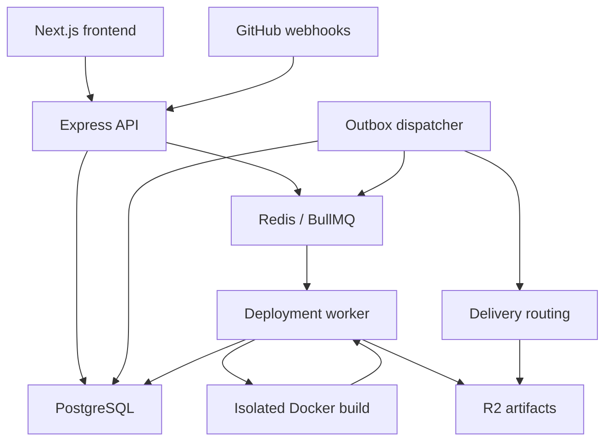

# 🚀 DeployMe · Backend

**From a GitHub repository to a published static website.**

DeployMe is a static-site deployment platform with personal projects, team collaboration, isolated builds, live deployment logs, and platform administration.

This repository contains the Express API, deployment worker, outbox dispatcher, database schema, and build infrastructure.


[Getting started](#getting-started) · [Architecture](#architecture) · [Permissions](#permissions) · [Testing](#testing) · [Production](#production)

---

## Overview

DeployMe handles the journey from repository selection to website publication:

1. Sign in with an email verification code.
2. Complete profile onboarding.
3. Connect GitHub and select a repository.
4. Choose a personal project or team destination.
5. Review detected build settings and choose an available subdomain.
6. Deploy and follow the build output.
7. Open the published website and manage future deployments.

Teams are optional. Users can deploy personal projects without creating a team.

> **Current scope:** static websites and frontend applications that produce static output. DeployMe does not currently provide a continuously running backend or SSR process for each customer project.

## Features

| Area | Capabilities |
|---|---|
| Authentication | Email OTP, onboarding, opaque sessions, logout, origin checks, rate limits |
| GitHub integration | GitHub App connection, repository inspection, import, webhook-driven deployment |
| Projects | Personal and team ownership, subdomain selection, build settings, public build variables |
| Builds | Isolated Docker execution, offline dependency preparation for supported npm/pnpm flows |
| Deployment activity | Status history, streamed logs, build duration, artifact statistics |
| Resource reporting | Recorded CPU time, peak observed memory, retry coverage |
| Collaboration | Invitations, acceptance, decline, revocation, membership roles, ownership transfer |
| Project sharing | Explicit View, Deploy, and Manage grants |
| Administration | Platform overview, users, account status, project records, health, audit history |
| Lifecycle management | Archiving, delivery changes, outbox processing, recovery and cleanup |

## Architecture



### Runtime processes

| Process | Responsibility |
|---|---|
| API | Authentication, authorization, project operations, integration endpoints, activity |
| Deployment worker | Claims jobs, prepares source, builds, uploads artifacts, finalizes records |
| Outbox dispatcher | Processes pending asynchronous work, delivery updates, and cleanup |

Website delivery is a separate part of the platform. Starting the API and workers alone does not configure public wildcard hosting.

## Technology

- **Runtime:** Node.js `>=22.15.0 <23`
- **Package manager:** pnpm `12.6.0`
- **API:** Express 5 and TypeScript
- **Database:** PostgreSQL with Prisma 7 and the PostgreSQL adapter
- **Queue:** Redis and BullMQ
- **Build execution:** Docker through Dockerode
- **Storage:** Cloudflare R2 through the S3 API
- **Email:** Resend
- **Validation and logging:** Zod and Pino

The pnpm version inside the customer build image is configured separately from the package manager used to develop DeployMe.

## Getting started

### Prerequisites

Have these available before running a complete deployment:

- Node.js and pnpm matching the repository requirements.
- A development PostgreSQL database.
- A development Redis instance.
- Docker with Linux containers.
- A configured GitHub App.
- Resend credentials and a usable sender.
- An R2 bucket and credentials.
- The companion frontend.

`compose.test.yml` supplies isolated **test services**. Do not use its disposable Redis configuration for production.

### 1. Install dependencies

```bash
git clone https://github.com/EzAkshat/deployme-server.git
cd deployme-server
pnpm install --frozen-lockfile
```

### 2. Configure the environment

Create `.env` using `.env.example` as a starting point. Review `deploy/server.env.example` for production-related settings.

For the local frontend running on port 3001, align these values:

```dotenv
NODE_ENV=development
API_HOST=127.0.0.1
PORT=3000

FRONTEND_ORIGIN=http://localhost:3001
ADMIN_ORIGIN=http://admin.localhost:3001
TRUST_LOCAL_PROXY=false
```

Supply your database, Redis, email, GitHub, and storage configuration before using their corresponding features.

| Variables | Purpose |
|---|---|
| `DATABASE_URL` | Prisma database connection |
| `REALTIME_DATABASE_URL` | Direct/session-affine PostgreSQL connection for LISTEN |
| `REDIS_URL` | Queue and Redis connectivity |
| `OTP_SECRET` | OTP protection; at least 32 characters |
| `RESEND_API_KEY`, `RESEND_FROM` | Email delivery |
| `FRONTEND_ORIGIN`, `ADMIN_ORIGIN` | Trusted application origins |
| `GITHUB_APP_ID`, `GITHUB_APP_PRIVATE_KEY` | GitHub App authentication |
| `GITHUB_WEBHOOK_SECRET` | Webhook verification |
| `GITHUB_APP_CLIENT_ID`, `GITHUB_APP_CLIENT_SECRET` | GitHub user authorization |
| `GITHUB_APP_CALLBACK_URL` | Registered authorization callback |
| `GITHUB_TOKEN_ENCRYPTION_KEY` | Exactly 64 hexadecimal characters |
| `R2_BUCKET_NAME`, `R2_ENDPOINT` | Artifact storage location |
| `R2_ACCESS_KEY_ID`, `R2_SECRET_ACCESS_KEY` | Storage credentials |
| `DOCKER_SOCKET_PATH` | Docker daemon connection |
| `PNPM_BUILD_IMAGE` | Full local Docker image ID for the pnpm build environment |
| `API_HOST`, `PORT` | API listener |
| `TRUST_LOCAL_PROXY` | Enables loopback proxy trust when configured |

Use a direct or session-affine database connection for realtime LISTEN traffic, not a transaction-pooling endpoint.

Never commit actual environment files, private keys, or access tokens.

### 3. Prepare the database

After configuring the development database:

```bash
pnpm exec prisma migrate dev
pnpm exec prisma generate
```

The generated client lives in `src/generated/prisma` and is excluded from Git.

### 4. Prepare the build images

Pull the pinned Node build image:

```bash
docker pull node@sha256:4b150b48b4116e2a22f2c39cc27025fbf4f153e2078fd3b14d159fdb5c7279da
```

Build the pnpm environment and inspect its ID:

```bash
docker build -f docker/pnpm-build.Dockerfile -t deployme-pnpm-build:12.18.0 .
docker image inspect deployme-pnpm-build:12.18.0 --format '{{.Id}}'
```

Set `PNPM_BUILD_IMAGE` in `.env` to the returned `sha256:...` value.

A local image ID from another machine is not automatically available on your Docker host.

### 5. Start the processes

Run each command in a separate terminal:

```bash
pnpm dev
```

```bash
pnpm worker:deployment
```

```bash
pnpm worker:outbox
```

The local API listens on `http://127.0.0.1:3000` with the configuration above.

Health endpoints:

- `GET /health`
- `GET /ready`

Start the frontend separately to use the application.

## Build execution

The current build configuration defines:

| Limit | Value |
|---|---:|
| Build timeout | 10 minutes |
| Memory per build | 2 GiB |
| CPU per build | 1 CPU |
| Processes per build | 256 |
| Maximum collected log size | 5 MiB |
| Worker concurrency | 2 deployments per worker process |

Build containers run as a non-root user with a read-only root filesystem, dropped capabilities, and no network access.

Supported npm and pnpm dependency flows prepare tarballs outside the build container and mount them read-only. Arbitrary commands that require internet access inside the container will not work.

The worker and Docker daemon must agree on the filesystem paths used for tarball mounts.

> CPU time and memory measurements describe build executions. They are not live resource usage for a published static website. Partial measurements can omit execution data; unavailable measurements are not zero usage.

## Permissions

Team roles and project grants serve different purposes.

| Capability | Owner | Manager | Member |
|---|---|---|---|
| View team projects | Role-based | Role-based | Explicit View grant |
| Manage team project settings | Role-based | Role-based | Explicit Manage grant |
| Deploy team projects | Explicit Deploy grant | Explicit Deploy grant | Explicit Deploy grant |
| Change project sharing | Yes | Yes | No |
| Invite and revoke invitations | Yes | Yes | No |
| Change team roles | Yes, with owner safeguards | No | No |
| Transfer ownership | Yes | No | No |

A member with Manage permission does not automatically gain sharing permission. Grant View as well when the member needs access through the project dashboard.

Platform roles are separate: `SUPER_ADMIN`, `SITE_ADMIN`, and `USER`. Administrator project summaries expose operational metadata; they do not automatically expose repository contents, secrets, or raw build logs.

## Invitations

- New invitation codes contain eight case-sensitive characters.
- Existing 64-character invitation tokens remain accepted for compatibility.
- Invitations expire after seven days.
- Opening an email link does not accept or decline the invitation.
- The signed-in account must match the invited email.
- Acceptance and decline coordinate through the existing team mutation lock.
- Accept and Decline share a limit of 10 requests per user per 15 minutes.

The current rate-limit stores are process-local. Counters reset on restart and are not shared across API instances.

## Commands

| Command | Purpose |
|---|---|
| `pnpm dev` | Run the API with source watching |
| `pnpm typecheck` | Check application types |
| `pnpm typecheck:test` | Check test types |
| `pnpm build` | Compile the backend into `dist` |
| `pnpm start` | Run the compiled API |
| `pnpm worker:deployment` | Run the deployment worker from source |
| `pnpm worker:outbox` | Run the dispatcher from source |
| `pnpm start:deployment` | Run the compiled deployment worker |
| `pnpm start:outbox` | Run the compiled dispatcher |
| `pnpm admin:bootstrap` | Run the super-admin bootstrap utility |

Review the bootstrap utility's inputs before running it against a database.

## Testing

The test Compose configuration provides:

| Service | Host address |
|---|---|
| PostgreSQL 17 | `127.0.0.1:55432` |
| Redis 7 | `127.0.0.1:56379` |

PostgreSQL uses a dedicated named volume. Test Redis persistence is disabled.

```bash
pnpm test:services:up
pnpm test:db:migrate
pnpm typecheck:test
pnpm test
```

Additional commands:

```bash
pnpm test:unit
pnpm test:integration
pnpm test:serial test/integration/admin/user-status-http.test.ts
pnpm test:services:stop
```

See [test/README.md](test/README.md) for test configuration and runner details. Never point the test runner at a production database.

## Repository guide

| Path | Contents |
|---|---|
| `src/routes` | HTTP routes |
| `src/middleware` | Authentication, origin checks, rate limits |
| `src/services` | Business logic, integrations, build and delivery lifecycle |
| `src/workers` | Deployment and outbox processes |
| `src/config` | Environment and dependency clients |
| `src/scripts` | Administrative and diagnostic utilities |
| `prisma` | Schema and migrations |
| `docker` | Customer build-image definition |
| `deploy` | Environment, reverse-proxy, and Linux-service templates |
| `test` | Automated tests |
| `scripts` | Test runner and repository tooling |

## Production

The backend and frontend production builds have passed during development. The end-to-end deployment flow has been exercised locally.

**Production rollout is still in preparation.** Deployment examples are templates, not evidence of a completed server installation.

Before launch:

- Select and provision the Linux host and data services.
- Configure real domains, HTTPS, GitHub callbacks, webhooks, and site delivery.
- Build and verify the Docker images on the worker host.
- Apply production migrations using `prisma migrate deploy`.
- Validate the systemd services and graceful shutdown.
- Finish trusted client-IP forwarding for frontend-originated OTP requests.
- Configure backups, restore procedures, monitoring, and storage maintenance.
- Verify the complete flow on the production infrastructure.

Docker-enabled workers have privileged access to their host. Container resource restrictions do not make the Docker daemon an unprivileged dependency.

## Troubleshooting

| Symptom | Check |
|---|---|
| API route returns 404 after adding it | Restart the API; rebuild first when running `dist` |
| Deployment stays queued | Deployment worker, Redis, worker presence, and outbox process |
| Build image cannot be found | Pinned Node image and configured pnpm image ID |
| Prisma reports missing fields | Migrations and regenerated Prisma Client |
| OTP email fails | Resend credentials, sender configuration, recipient, and rate limits |
| Realtime updates fail | Direct PostgreSQL connection, API stream, frontend stream proxy |
| Archived website remains briefly available | Pending delivery shutdown/outbox work |

---

Built by **Akshat Naik**.